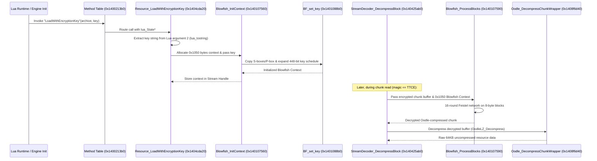

# TTCE Encryption Path & Cryptographic Analysis

## Summary
The TTCE (`0x54544345`) archive encryption system has been reverse engineered from the raw binary `Minecraft2.exe`. The cipher utilized is **Blowfish** (operating on 64-bit blocks with standard Bruce Schneier S-Boxes and P-Arrays). OpenSSL is statically compiled into the binary, but the archive streaming engine invokes a dedicated in-engine Blowfish implementation with key setup and block decryption primitives.

---

## 1. End-to-End Cryptographic Execution Pipeline



---

## 2. Cryptographic Components & Assembly Trace

### A. Cipher Algorithm Verification
- **Algorithm**: Blowfish (16-round Feistel cipher).
- **Block Size**: 64 bits (8 bytes).
  - Enforced in `Blowfish_ProcessBlocks` (`0x140107598`):
    ```assembly
    test r8b, 7        ; verify length is a multiple of 8 bytes
    jne  0x1401079fb   ; error branch if unaligned
    shr  r8d, 3        ; block_count = length / 8
    ```
- **Context Size**: `0x1050` bytes (4,176 bytes allocated via `0x1404cda7b: mov ecx, 0x1050; call operator_new`).
  - Structure:
    - `0x0000..0x0047`: 18 x 32-bit P-box array (72 bytes).
    - `0x0048..0x1047`: 4 x 256 x 32-bit S-box arrays (4,096 bytes).
    - `0x1048..0x104F`: Context flags and alignment padding.
- **Constant Tables**: Located at `.rdata:0x140c3c560` (P-Box) and `.rdata:0x140c3c5b0` (S-Boxes), matching the fractional hexadecimal digits of $\pi$.

---

## 3. Function Catalog

| Function Address | Identification | Confidence | Evidence |
| :--- | :--- | :--- | :--- |
| `0x1401088b0` | `BF_set_key` | 100% (Confirmed) | Copies initial P-box and S-boxes from `.rdata:0x140c3c560`, XORs key bytes into P-array, and iteratively expands subkeys via cipher rounds. |
| `0x140107560` | `Blowfish_InitContext` | 100% (Confirmed) | Clears state flags, invokes `BF_set_key`, and returns pointer to the populated `0x1050` byte context. |
| `0x140107590` | `Blowfish_ProcessBlocks` | 100% (Confirmed) | Validates 8-byte block alignment, loops over `count / 8` iterations executing the 16-round Blowfish cipher. |
| `0x1404cda20` | `Resource_LoadWithEncryptionKey` | 100% (Confirmed) | Lua C-function registered as `"LoadWithEncryptionKey"` at `0x1400213b7`. Extracts key from Lua stack argument 2 and initializes the context. |
| `0x140425e08` | Chunk Decryption Dispatch | 100% (Confirmed) | Inside `StreamDecoder_DecompressBlock` (`0x140425ab0`), decrypts chunk buffer via `Blowfish_ProcessBlocks` prior to decompression. |

---

## 4. Key Storage & Derivation Analysis

- **Storage**: Keys are not hardcoded as plain static strings directly in the executable. Instead, `Resource_LoadWithEncryptionKey` receives the key dynamically from the scripting layer or resource descriptor initialization.
- **Invocation**: Lua scripts invoke `Resource.LoadWithEncryptionKey(archive_path, key)`.
- **Known Historical Precedents**: In Telltale Tool games (e.g., *Batman*, *Guardians of the Galaxy*, *MCSM Season 1*), archive keys were derived from project-specific passphrases or build strings.
- **Verification Plan**:
  - Dump decrypted Lua scripts (`_project.lua`, `_boot.lua`) or extract the key by inspecting memory passed to `0x140107560` (`rdx`).
