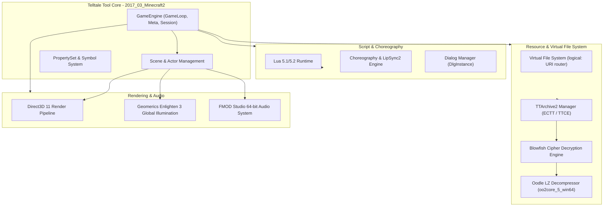

# Telltale Tool Engine Architecture (2017 Edition)

## Architecture Overview

The Telltale Tool is Telltale Games' proprietary multi-platform game engine. Originating in 2004, it evolved through five major generations. The build used in **Minecraft: Story Mode - Season Two** represents the **Generation 5 (Post-Batman 2016)** overhaul.

---

## Key Subsystems

### 1. Resource & Virtual File System
- **URI Addressing**: Resources are identified via URI strings, e.g.:
  `logical:<Tool DLL>/9004` or `logical:minecraft201/`
- **Mounting**: Scripts call `ResourceCreateConcreteArchiveLocation` to map archives into logical namespaces.
- **Resource Identification**: Fast lookup is powered by 64-bit `Symbol` CRC hashes rather than string paths.

### 2. Rendering & Radiosity (Gen 5 Overhaul)
- Unlike Gen 3/4 engines which used Direct3D 9, Minecraft: Story Mode Season 2 exclusively uses Direct3D 11 (`d3d11.dll`).
- Integrated with **Geomerics Enlighten 3** (`RenderEnlighten.cpp`, `EnlightenUtils.inl`) for dynamic global illumination, adaptive probe volumes, and precomputed lightmap clustering.

### 3. Compression & Encryption
- In Gen 3 and Gen 4 engines, Telltale used Zlib compression (`.ttarch`).
- In Gen 5 (Batman, Guardians of the Galaxy, MCSM Season 2), Telltale transitioned to **RAD Game Tools Oodle LZ** (`oo2core_5_win64.dll`) with 64 KB chunked blocks.
- Archive payloads are encrypted using **Blowfish** cipher blocks.

### 4. Lua Scripting Environment
- Core game logic, UI event binding, and episode choreography are orchestrated via Lua scripts.
- Engine contains compatibility wrappers (`ttFixupLua51Script`, `ttFixupLua50Script`) to reconcile language differences between scripts and engine bindings.
