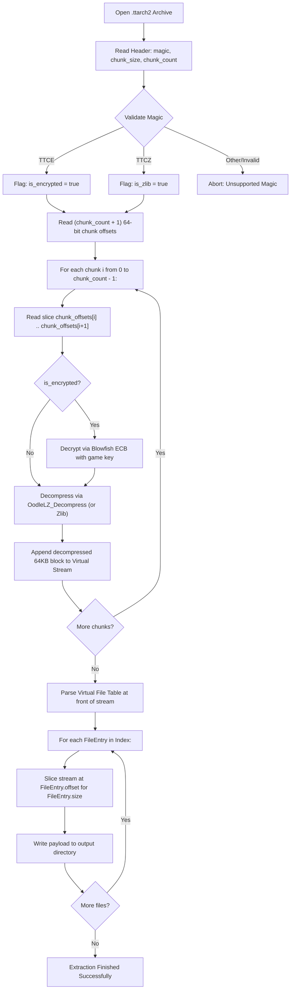

# TTARCH2 Extractor Architecture & Design Specification

## Overview
This document specifies the software architecture, memory model, and algorithmic flow for a clean-room extractor targeting Minecraft: Story Mode Season 2 `.ttarch2` packages (`ECTT` / `TTCE`).

---

## 1. Required Libraries & Runtime Dependencies

1. **Oodle Data Decompression Library**:
   - `oo2core_5_win64.dll` (shipped in game root).
   - Export: `OodleLZ_Decompress(const void* compBuf, size_t compBufSize, void* rawBuf, size_t rawLen, int fuzzSafe, int checkCRC, int verbosity, void* decBufBase, size_t decBufSize, void* fpCallback, void* callbackUserData, void* decoderMemory, size_t decoderMemorySize, int threadPhase)`.
2. **Blowfish 64-Bit Cipher Engine**:
   - Standard Blowfish implementation in ECB block mode.
   - 448-bit key schedule expansion matching `0x1401088b0`.
3. **CRC64 / Symbol Hash Resolver**:
   - Telltale 64-bit Symbol CRC calculation for matching filenames to hashes.

---

## 2. Core Data Structures

```cpp
#pragma pack(push, 1)

// Archive header on disk
struct ArchiveHeader {
    uint32_t magic;           // 0x54544345 ("ECTT" / TTCE)
    uint32_t chunk_size;      // 0x00010000 (65,536 bytes)
    uint32_t chunk_count;     // Total number of blocks N
};

// Virtual file table entry
struct FileEntry {
    uint64_t name_hash;       // 64-bit Symbol CRC
    uint64_t offset;          // Absolute byte offset in decompressed stream
    uint32_t size;            // Uncompressed size
    uint32_t flags;           // Resource attribute flags
};

#pragma pack(pop)
```

---

## 3. Extraction Algorithm



---

## 4. Implementation Phasing
- **Phase A**: Verify Blowfish key from dynamic execution.
- **Phase B**: Build standalone parser (`parser.py` / `parser.cpp`) validating chunk extraction against `oo2core_5_win64.dll`.
- **Phase C**: Full batch extractor outputting recovered resources to `extracted_assets/`.
